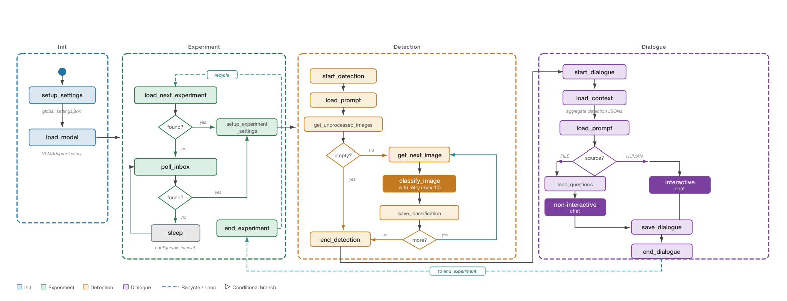
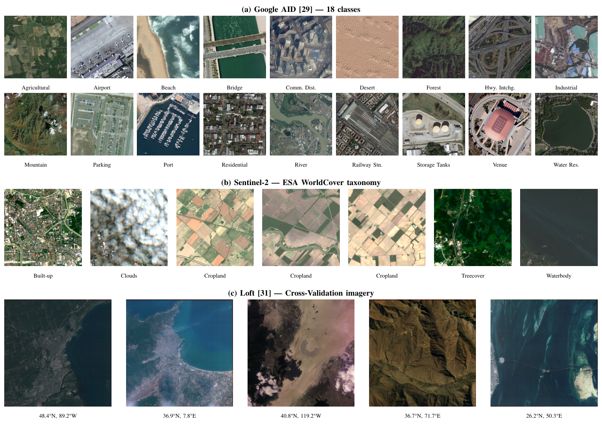
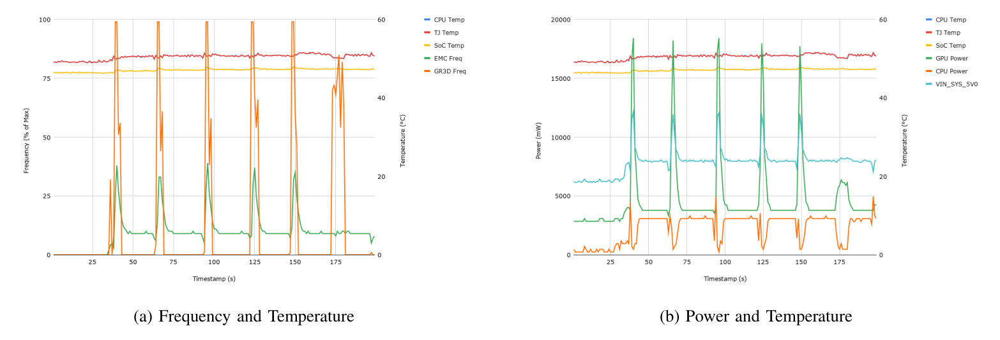
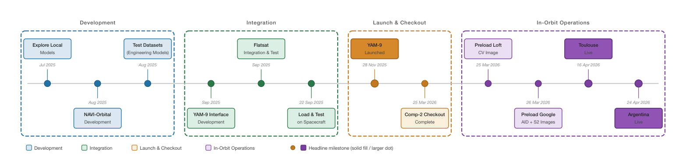
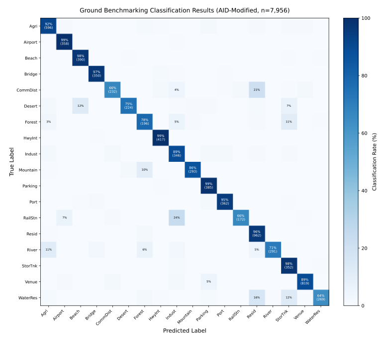
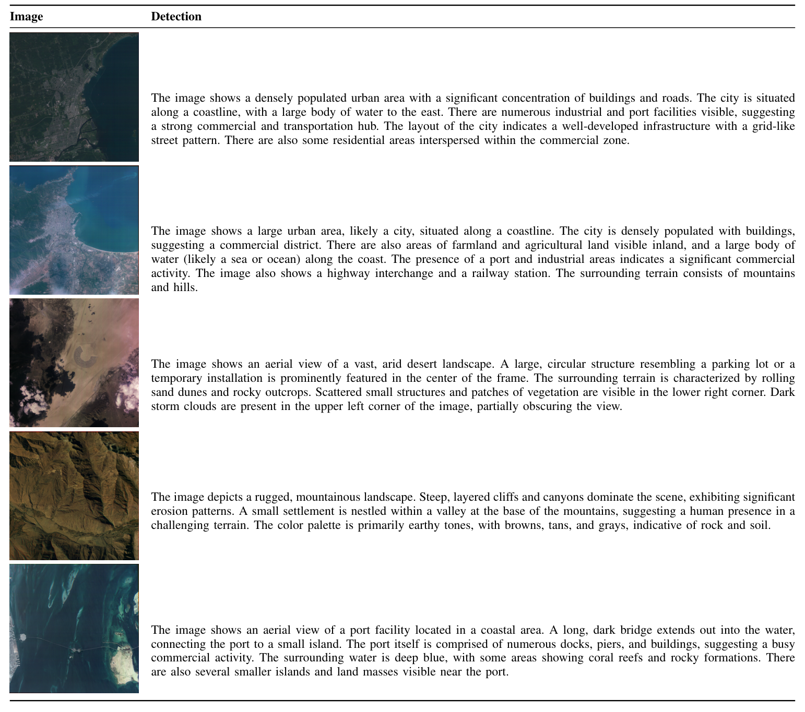
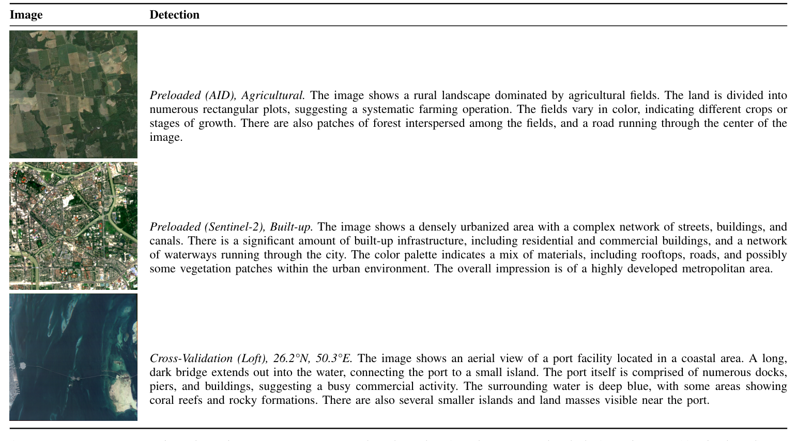
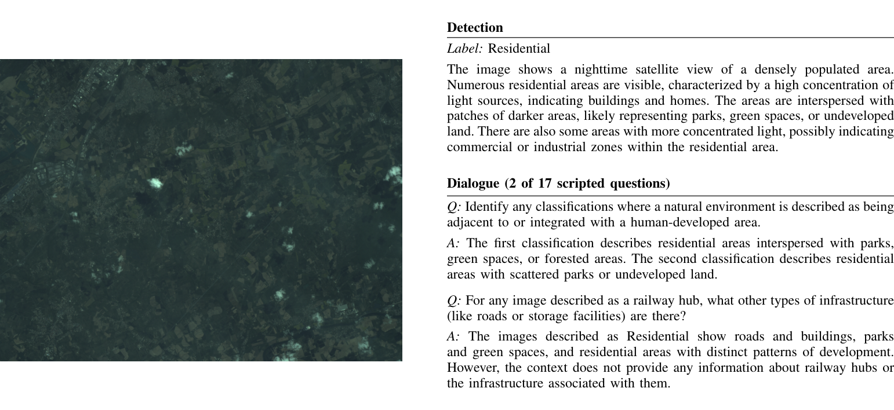
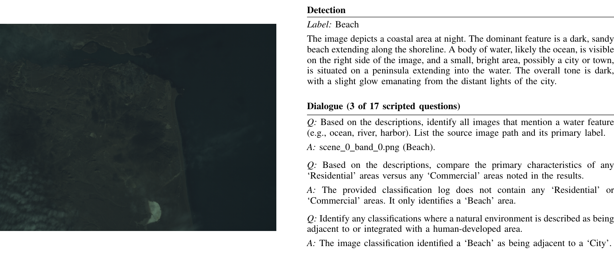
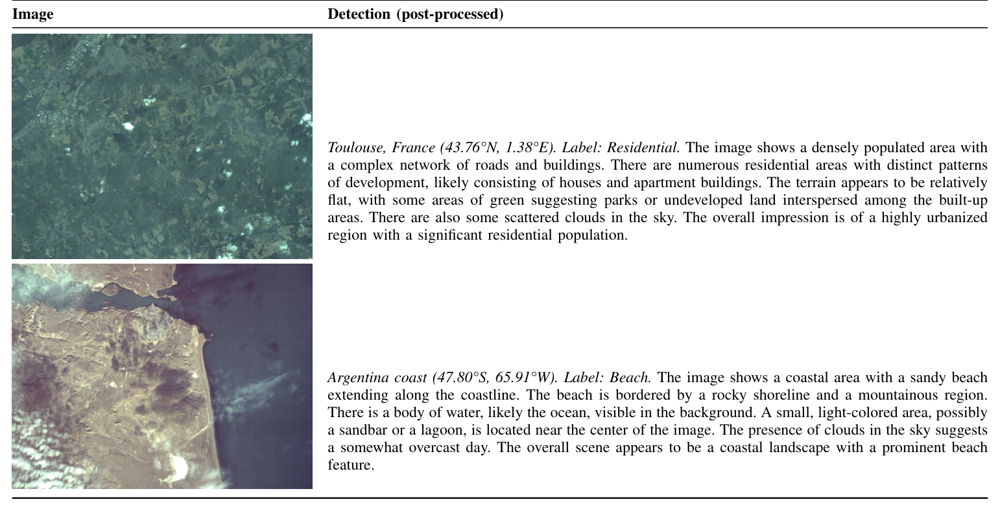

# NAVI-Orbital: First In-Orbit Demonstration of a Zero-Shot Vision-Language Model for Autonomous Earth Observation

**Juan M. Delfa Victoria** (Jet Propulsion Laboratory, California Institute of Technology)  
**Taran Cyriac John** (Jet Propulsion Laboratory; School of Engineering and Computer Science, Victoria University of Wellington)  
**Andrew W. Herson** (Loft Orbital)

Contact: juan.m.delfa.victoria@jpl.nasa.gov; taran.john@jpl.nasa.gov; andrew.herson@loftorbital.com

## Conversion notes for machine readers

- This is a faithful semantic transcription of the attached 17-page paper. The paper's section order, claims, numeric results, prompts, tables, captions, and references are retained.
- Multi-column floating figures and tables have been moved next to the text that discusses them. This changes page layout, not meaning.
- Extracted graphics are stored in `navi-orbital-paper-assets/` and referenced with relative Markdown paths.
- Alt text and short **Converter note** passages were written during conversion to expose visual content to models that cannot inspect images. They are not claims made verbatim by the paper.
- PDF line-break hyphenation and page headers/footers were removed. Inline software names and paths are marked as code where doing so improves parsing.

## Machine-oriented synopsis (converter-provided)

**Central claim:** NAVI-Orbital performed autonomous vision-language inference entirely onboard Loft Orbital's YAM-9 spacecraft on April 16, 2026. The authors present it as the first in-orbit demonstration of a VLM processing newly captured Earth imagery without a ground-in-the-loop connection.

**System:** A quantized Gemma 3 4B vision-language model is wrapped in a LangGraph state machine with orchestration, detection, and dialogue functions. Operators can change target labels and questions through text prompts rather than retraining the model.

**Evidence:** Ground evaluation reports 88.16% accuracy and macro F1 = 0.87 on 7,956 valid predictions from a curated 18-class AID benchmark. Hardware validation used a YAM-9 engineering/Flatsat stack. In orbit, the system processed preloaded examples and two live captures (Toulouse and the Argentina coast).

**Primary caveat:** Only two live captures are reported, and the dialogue agent was not adversarially evaluated. A stochastic VLM is not formally deterministic or safe merely because retries and regex validation are used.

## Abstract

As Earth Observation data generation outpaces downlink bandwidth and human-in-the-loop processing, a widening gap has emerged between onboard collection and actionable ground intelligence. This paper presents NAVI-Orbital, a software system deployed on a Low Earth Orbit (LEO) spacecraft. On April 16, 2026, NAVI-Orbital achieved what is, to the authors' knowledge, the first in-orbit demonstration of a vision-language model performing autonomous multi-modal inference entirely onboard. NAVI-Orbital uses a local vision-language model (Gemma 3) to classify each captured scene, produce a text description of its content and the relationships between its features, and respond to operator follow-up via natural-language dialogue. The system is re-tasked through plain-English prompts in place of conventional command sequences, and is orchestrated by a graph-based state machine (LangGraph) coordinating dedicated agents for detection and dialogue. Results across ground benchmarking (88.16% accuracy on the 7,960-image curated AID benchmark), Flatsat validation, and live in-orbit captures of newly acquired, previously unseen Earth imagery (including uncorrected YAM-9 imagery, processed onboard with hardware-accelerated GPU inference and no fine-tuning for the flight instrument) demonstrate the feasibility of running foundation models on satellite-class edge computers to invert the conventional acquire-then-downlink-everything bandwidth profile through semantic compression of Earth observations in orbit.

**Index terms:** Earth Observation; Vision-Language Models (VLM); Onboard AI; Foundation Models; Zero-shot Learning; Edge Computing; In-Orbit Demonstration; Semantic Compression; Spacecraft Autonomy.

## 1. Introduction

Modern Earth Observation (EO) instruments are generating data at rapidly increasing rates, yet the two critical pathways for managing that volume, physical downlink bandwidth and human-in-the-loop review capacity, cannot scale proportionally. This creates a widening gap between onboard data generation and exploited information available to ground operators [1]. Onboard processing offers a partial remedy, but current implementations are largely limited to “specialist detectors”: algorithms trained to identify specific, pre-defined pixel patterns (e.g., drawing a bounding box around a ship) [2]. These systems are effective within their narrow scope, but adapting them to new phenomenologies requires retraining models, validating new binaries, and executing complex software updates, a process that is slow, expensive, and fundamentally at odds with the agility that future missions demand.

### A. NAVI-Orbital

NAVI-Orbital is a software framework developed by researchers at NASA Jet Propulsion Laboratory (JPL) and deployed onboard Loft Orbital’s YAM-9 Low Earth Orbit (LEO) spacecraft that uses a multi-modal large language model (Google’s Gemma 3 [3]) to understand the content of images and describe it in plain English. By jointly processing visual and textual information, the model develops a semantic understanding of scene content, producing contextualized descriptions that identify not just what objects and features are present in an image but also the relationships between them (e.g., “a highway cutting through a forested area”). Unlike traditional specialist detectors that require retraining for each new target class, NAVI-Orbital leverages the open-vocabulary nature of vision-language models [4], [5], enabling it to adapt to new observation tasks through prompt modifications alone, without altering the underlying model architecture (Section III-B). This capability will enable future satellites to react intelligently to their environment rather than operating as passive sensors responding to predetermined triggers.

The system operates through a sequence of steps, from image reception to human-spacecraft dialogue. A user uploads a plain-English prompt defining what to look for and a list of target labels. NAVI classifies each image, generates a text description of the scene, and stores a structured record for every image. Compact text summaries are downlinked to the ground, where operators review them and request full images only for high-value scenes. Provided the spacecraft has direct communication with Earth, a human operator can further interrogate the results through scripted question sets or interactive chat.

This pipeline is orchestrated by a multi-agent architecture composed of three self-contained agents that hand off work to each other: an orchestrator that coordinates execution, a detector that analyzes, classifies, and summarizes images, and a dialogue agent that enables operators to ask questions about the results. This design makes NAVI adaptable to different missions without rebuilding from scratch.

### B. Contributions

The primary contributions are:

- **First In-Orbit Multi-Modal Inference:** NAVI actively processes fresh, live imagery directly from the spacecraft’s sensors. The Gemma 3 model runs with hardware-accelerated GPU inference on a satellite-class edge processor under strict size, weight, and power constraints, demonstrating that complex, multi-agent AI workflows can execute on edge computing hardware onboard a spacecraft.

- **Generalist Knowledge Without Retraining:** Large-scale models trained on internet-scale datasets possess generalized recognition capabilities that eliminate the need for individualized retraining for every specific concept or instrument. NAVI leverages this zero-shot capability to adapt to new observation tasks by changing text prompts alone, without altering the core software or deploying new neural network architectures. The system was validated across approximately 7,000 images spanning multiple datasets and multiple hardware platforms, and successfully processed live YAM-9 imagery without any specialized fine-tuning for that optical instrument, including uncorrected live imagery.

- **Multi-Modal Contextual Reasoning:** By leveraging a Vision-Language Model (VLM), NAVI develops a semantic understanding of observed scenes. Traditional onboard classifiers output only discrete labels or bounding boxes with no contextual awareness. NAVI instead produces rich, contextualized descriptions, enabling knowledge-driven autonomy where the spacecraft interprets its environment rather than merely detecting predetermined targets.

- **Plain-English Operations:** NAVI replaces complex spacecraft commanding and data retrieval with natural language for the entire input/output loop. On the uplink, operators define what to look for using simple text prompts, specifying target labels and processing instructions rather than rigid command sequences. On the downlink, the spacecraft returns plain-English text summaries of every image it processes. Operators can further interrogate results through scripted question sets or interactive chat, selectively downlinking only high-value imagery and thereby optimizing limited communication windows [1]. When an Intersatellite Link (ISL) is available, this dialogue can occur in near real-time, transforming the entire interaction loop with the satellite into an intuitive, natural conversation.

### C. Paper Organization

The remainder of this paper is organized as follows. Section II surveys related work in onboard AI, generative models on manned platforms, and vision-language models in remote sensing. Section III describes the system architecture, including the LangGraph-based conductor graph, agent ecosystem, and hardware integration. Section IV details the experimental setup, datasets, and phased validation approach. Section V presents results from ground benchmarking, Flatsat validation, and in-orbit demonstration. Sections VI and VII discuss implications, limitations, and conclusions.

## 2. Related Work

### A. Onboard AI for Earth Observation

The transition from ground-in-the-loop operations to onboard autonomy has been driven by the need to maximize spacecraft science utility. The Autonomous Sciencecraft Experiment (ASE) on EO-1 pioneered the use of onboard classifiers to detect features like volcanic activity and trigger subsequent data acquisitions [6]. As space-rated computational hardware matured, the focus shifted toward Deep Neural Networks. The Φ-Sat-1 mission demonstrated the efficacy of dedicated hardware accelerators for filtering cloud-covered imagery using Convolutional Neural Networks (CNNs) [7]. While highly effective, these systems rely on fixed-class supervision. Adapting them to new phenomenologies traditionally required complex, monolithic software updates. To address this limitation, recent missions have validated retrainable AI architectures in orbit. Early work demonstrated the feasibility of machine learning for global flood mapping on resource-constrained satellite hardware [8], establishing the foundation for adaptive onboard segmentation. This approach was later extended to orbital deployment with the in-orbit demonstration of a re-trainable machine learning payload aboard D-Orbit’s ION satellite, where segmentation models were continuously updated post-launch to maintain high accuracy for dynamic flood detection tasks [9]. Concurrently, the European Space Agency’s OPS-SAT nanosatellite has served as a dedicated orbital testbed, allowing diverse deep learning algorithms (such as the SmartCam application) to be dynamically uploaded, hybridized, and executed on edge hardware in space [10]. Pushing the boundaries of data reduction even further, missions like KP Labs’ Intuition-1 [11] and HYPSO-1 [12] have recently utilized onboard DNNs to process hyperspectral data directly in orbit, converting raw instrument data into actionable intelligence and substantially decreasing the volume of telemetry transmitted to the ground.

Scaling beyond single algorithms, contemporary architectures now support concurrent, multi-application processing; Wuhan University’s Luojia3 leverages heterogeneous parallel computing for simultaneous application execution [13], and ESA’s Φ-Sat-2 executes complete end-to-end data processing chains natively in orbit. Beyond static image processing, Dynamic Targeting (DT) extends onboard autonomy by utilizing a “lookahead” sensor to analyze the scene ahead of the satellite’s ground track. This enables the primary instrument to autonomously slew and capture high-value targets with elevated precision. Recent flight demonstrations on the CogniSAT-6 spacecraft have validated DT in Low Earth Orbit (LEO) environments, successfully utilizing edge computing to perform lookahead analysis and drive primary sensor tasking in real-time [14].

However, despite these significant advancements, current implementations generally rely on specialized, pre-trained classifiers customized for specific targets (e.g., clouds, floods, or thermal anomalies) rather than open-vocabulary interpretation.

### B. Generative AI in Space

Parallel to advances in autonomous remote sensing, early efforts have emerged in deploying Large Language Models (LLMs) to support both manned spaceflight and autonomous subsystem control. In 2024, a text-based generative AI model was deployed aboard the International Space Station (ISS) utilizing the HPE Spaceborne Computer-2 infrastructure. This system was designed to assist astronauts with maintenance procedures through Retrieval-Augmented Generation (RAG) [15]. In 2025, this paradigm advanced with “Space Llama,” a collaboration between Meta and Booz Allen that successfully deployed a quantized Llama 3.2 model to the ISS [16].

Functioning as a multimodal digital assistant, Space Llama facilitates scientific and technical tasks, including predictive maintenance and autonomous access to documentation, effectively replacing physical space manuals for the crew. While Space Llama exemplifies the utility of LLMs as interactive aides, recent research has transitioned toward active agentic supervision. The ASTREA (Agentic System for Thermal Regulation and Embedded Adaptation) mission represents the first agentic system executed on flight-heritage hardware for autonomous operations, with in-orbit validation aboard the ISS [17]. ASTREA utilizes an asynchronous hybrid architecture wherein a resource-constrained LLM provides strategic, semantic guidance to a real-time reinforcement learning controller tasked with orbital thermal regulation [17]. Ground and in-orbit experiments demonstrated that this semantic reasoning capability improves thermal stability, extends episode durations, and optimizes CPU utilization, demonstrating the viability of combining LLMs with adaptive control under strict hardware constraints.

### C. Key Technologies for Generative AI in Space

#### 1. Edge Inference and Hardware Optimization

The deployment of multi-billion parameter foundation models onto constrained spacecraft buses necessitates extensive hardware abstraction and memory optimization. The `llama.cpp` framework provides a dependency-free, C/C++ inference engine that interacts directly with edge CPUs and neural processing units (NPUs) [18]. To mitigate severe memory bandwidth bottlenecks, researchers increasingly employ block-wise quantization techniques to reduce tensor precision [19]. Recent unified evaluations of quantization formats confirm that sub-byte integer representations significantly reduce memory footprints while preserving complex reasoning and instruction-following capabilities [20].

#### 2. Vision-Language and Geospatial Foundation Models

Generative models deployed in orbit must be tailored to comprehend the unique spatial and spectral characteristics of Earth observation telemetry. NAVI-Orbital uses the Gemma 3 4B instruction-tuned model in its `Q4_0` GGUF quantization with a dedicated multimodal projector (mmproj) for vision - language fusion. This model introduces hybrid interleaved attention, significantly reducing the Key-Value (KV) cache memory overhead required to process long contexts of up to 128K tokens [3]. It also utilizes a dynamic “Pan and Scan” visual integration strategy to preserve critical high-resolution metadata without destructive down-sampling [3]. Within the remote sensing domain specifically, RemoteCLIP pioneered contrastive alignment to bridge textual descriptions and orbital imagery, enabling open-vocabulary, zero-shot classification and retrieval [21]. GeoChat expanded these capabilities by introducing grounded spatial reasoning, allowing models to process and output precise bounding-box coordinates interleaved with natural language [22]. Addressing the large variance in satellite imagery, RSCoVLM implements a unified dynamic-resolution strategy and multi-task learning (MTL), evaluating generative outputs against strict object detection metrics [23].

At the most comprehensive scale, TerraMind demonstrates the efficacy of large-scale modality integration, processing both pixel-level and token-level representations across diverse geospatial data types [24].

#### 3. Agentic Orchestration Frameworks

Translating probabilistic outputs from vision-language models into deterministic spacecraft commands requires robust supervision. Recent surveys on multi-agent orchestration highlight the necessity of structured communication protocols and state management to ensure safety in autonomous systems [25]. Taxonomies of agentic AI distinguish between simple linear chains and complex, stateful graph orchestrations, emphasizing the latter’s superiority for applications requiring human-in-the-loop oversight and automated error recovery [26]. Frameworks such as LangGraph provide this essential low-level orchestration by modeling multi-agent interactions as directed cyclic graphs with persistent memory [27]. This structure ensures that cognitive tasks are safely compartmentalized, repeatedly validated, and preserved across hardware reboots before interacting with critical flight software.

### D. Positioning NAVI-Orbital

The operational paradigm of NAVI-Orbital differs from these prior generative AI deployments in three fundamental ways. First, unlike systems hosted within the pressurized environment of the ISS [15] - [17], NAVI-Orbital is deployed directly onboard an autonomous Earth observation spacecraft. Second, rather than relying on rack-mounted server infrastructure, it executes entirely on a power-constrained ARM-based edge computing platform. Third, while early spaceborne LLMs focus primarily on text-based assistance or internal subsystem regulation, NAVI-Orbital focuses on multi-modal image semantic understanding. By natively processing visual data, it bridges the gap between external perception and semantic reasoning, autonomously translating raw remote sensing imagery into contextualized information without human intervention.

## 3. System Architecture

### A. The YAM-9 Platform

NAVI-Orbital runs on Loft Orbital’s YAM-9 satellite, a multi-mission platform flying a heterogeneous compute cluster composed of multiple edge-class processing elements designed for operation in harsh LEO environments. Its open compute architecture allows the deployment and operation of custom software and foundation models, and builds on Loft’s existing in-orbit compute infrastructure. NAVI-Orbital was originally optimized for a specific ARM/GPU execution environment. The system architecture targets high-performance edge processors commonly used in modern smart satellites. Platform variants include Qualcomm’s Snapdragon, NVIDIA’s Orin-series devices, and similar devices capable of hosting Gemma 3 4B (requires a minimum of 8 GB of VRAM). Since its initial deployment, however, the application has been generalized to operate across multiple compute elements, enabling flexible task distribution and broader portability.

### B. NAVI-Orbital Software Architecture

NAVI-Orbital implements a hierarchical, agentic architecture designed to operate autonomously within the constraints of edge-computing hardware on a spacecraft. The core logic is orchestrated by a state machine implemented using LangGraph [26], [28], which manages the flow of control between three distinct functional layers: the Conductor (Orchestration), the Detector (Reasoning), and the Dialogue (Interaction) agents. During architecture evaluation, the Anthropic Model Context Protocol (MCP) was considered as an alternative orchestration framework. However, LangGraph was ultimately selected because its graph-based state machine provides deterministic, verifiable transitions between operational phases. This was a key requirement for onboard applications where predictable behavior and state traceability are essential for autonomous spacecraft operations. The underlying vision-language model and NAVI-Orbital’s prompt-based architecture are inherently open-vocabulary [4], [5], capable of recognizing and describing arbitrary visual concepts without task-specific retraining. However, for operational deployment, each experiment is configured with a constrained label set passed in the detection prompt (Section IV-A). This design choice trades some of the model’s generality for output determinism: by restricting the model to a predefined vocabulary, the system ensures that classification results are parseable by downstream spacecraft subsystems and compatible with the regex-based validation gate in the Detector Agent’s retry loop (Section III-B). This hybrid approach preserves the model’s zero-shot adaptability (new label sets require only a prompt edit, not model retraining) while maintaining the deterministic output semantics required for autonomous operation.

#### 1. Core Layer

The Core Layer provides the foundation that every agent builds on: a control plane, a bus-facing I/O interface, model abstractions, and shared utilities.

##### a. Control Plane

A FastAPI service (api.py) exposes lifecycle endpoints (`/start`, `/stop`, `/kill`), configuration endpoints (`/get-config`, `/reload-config`), and a `/health` probe reporting workflow status, accelerator availability, and path validity. The agent graph is spawned as a separate `multiprocessing.Process`, so the control plane remains responsive and can reclaim GPU memory by terminating the worker without restarting the service.

##### b. Inbox/Outbox Interface

All interaction with the spacecraft bus is mediated by two filesystem queues. An external producer deposits a session descriptor (a JSON file listing a session_id and target images) into `io/inbox/`; the Conductor polls this directory once preloaded and template-based experiments are exhausted (Section III-B). On completion, the Conductor writes an aggregated result JSON containing detections, dialogue transcript, and log excerpts to `io/outbox/`, where it is retrieved by the bus. This file-based contract decouples NAVI-Orbital from any specific spacecraft communication protocol and matches the asynchronous, store-and-forward nature of typical satellite telecommand and telemetry links.

##### c. Model Abstraction

A `VLMAdapter` abstract base class is implemented by `GemmaVLAdapter` (HuggingFace pipeline) and `LlamaCppAdapter` (GGUF via `llama.cpp` with a multimodal projector). A factory selects the concrete adapter from `model_settings.json`, and each adapter negotiates a device-appropriate precision (4-bit, 8-bit, bfloat16, float16, or float32) with a fallback chain tuned per CUDA, MPS, and CPU. For HuggingFace models, runtime quantization is applied via `bitsandbytes` (4-bit or 8-bit); for GGUF models, quantization is embedded into the model file at export time (e.g., `Q4_0`), and the adapter loads the pre-quantized weights directly.

##### d. Utilities and Configuration

A shared `file_handler` module owns experiment discovery, image scanning, and result serialization; a logging module provides dual file/console output with per-experiment archival; and a context-manager utility redirects Clevel stdout/stderr from `llama.cpp` into the experiment log so native engine traces are preserved



**Figure 1 - The Conductor Graph.** A directed state graph composed of four subgraphs. Rounded rectangles represent LangGraph nodes; dashed borders group nodes by subgraph; diamonds denote conditional edges. The outer loop recycles from `end_experiment` to `load_next_experiment` for continuous autonomous operation. **Converter note:** The flow initializes settings/model, searches or polls for an experiment, classifies all pending images with retries, optionally runs file-based or human dialogue, saves results, and loops.

alongside Python-level events. Two JSON files anchor configuration: `global_settings.json` (paths only) and `model_settings.json` (adapter selection, weights, device, precision, and inference hyperparameters), the latter hot-reloadable via the API while the workflow is idle.

#### 2. Agents Layer

The architectural backbone of NAVI-Orbital is the Conductor Graph, a directed state graph implemented in LangGraph that enforces deterministic transitions between operational phases. The graph is assembled from four composable sub-graphs, each encapsulating a distinct phase of the processing pipeline (Fig. 1):

#### 1. Init Sub-graph

Loads global configuration (`global_settings.json` ), instantiates the VLM adapter, and transitions to the experiment phase.

#### 2. Experiment Sub-graph

Implements a three-stage experiment loading priority: (i) existing unprocessed experiment folders, (ii) mandatory template-based experiments (e.g., preloaded datasets), and (iii) live inbox polling with a configurable sleep interval. Each experiment run is assigned a unique UUID. This subgraph contains conditional edges that route to either experiment setup or a poll-sleep loop when no work is available.

#### 3. Detection Sub-graph

Manages the image processing pipeline: loading prompts, iterating through the image queue, invoking the classify-with-retry loop, and serializing results. A conditional edge after each classification checks whether images remain in the queue, looping back or terminating the phase accordingly.

#### 4. Dialogue Sub-graph

Aggregates detection results into a context window, then branches conditionally into either interactive (live chat) or non-interactive (filebased batch) dialogue mode based on the experiment configuration. The system tracks its operational phase via a Status enumeration (IDLE, TRANSITION, DETECTION, DIALOGUE ), which is orthogonal to the graph nodes and is used for logging and state persistence. Upon completing all phases, the graph cycles back from end_experiment to load_next_experiment, creating a continuous autonomous processing loop.

## 4. Experimental Setup

### A. Workflow

NAVI-Orbital operates as a persistent service. Once started, the engine enters an idle state and awaits a JSON experiment descriptor that specifies the image source, label set, detection prompt, and dialogue configuration. Upon receipt, the Conductor Graph (Section III-B) drives execution through the Detection and Dialogue sub-graphs described in Section III-B, then cycles back to the experiment loader. The classify-withretry loop is configured for up to 3 attempts during ground evaluation and up to 10 attempts during flight. Two experiment modes govern how images are sourced:

- **Preloaded Mode (Validation):** The system ingests static datasets (e.g., Google AID, Sentinel-2) from a local directory to benchmark model performance against known ground truth.

- **Live Mode (Flight):** The system polls the inbox for new imagery captured by the spacecraft bus, processing files in real-time as they are written to disk.

### B. Datasets

#### 1. Google AID

The primary evaluation dataset is derived from the Aerial Image Dataset (AID) [29], a large-scale benchmark comprising approximately 10,000 images across 30 aerial scene classes at 600×600 px resolution. We curated AID to 18 classes totaling 7,960 images through two complementary strategies. First, semantic deduplication collapsed classes with overlapping visual semantics: Dense Residential, Medium Residential, and Sparse Residential were merged into a single Residential class; Meadow was absorbed into Agricultural; BareLand was subsumed by Desert; Park by Forest; and Viaduct by Bridge. Stadium was relabeled to Venue to better reflect operational label semantics. Second, a mission-relevance filter removed seven classes whose defining features are sub-pixel-scale and therefore unlikely to be discriminable from LEO optical instruments: BaseballDiamond, Church, School, Center, Resort, Square, and Playground. The resulting 18-class subset retains the diversity of the original benchmark while reflecting labels that a satellite-borne classifier would plausibly encounter.

The curated dataset spans natural landscapes (Forest, Desert, Mountain, River, Beach) and anthropogenic infrastructure (Airport, Port, Industrial, Bridge, Highway Interchange, Parking, Storage Tanks, Railway Station, Commercial District, Venue, Residential, Water Reservoir, Agricultural). Class sizes range from 250 (Forest) to 1,000 (Residential) with a mean of 442 images per class. Evaluation uses the identical deployment prompt and response parser described in Section III-B; no special evaluation harness is employed. The model configuration matches the flight build: Gemma 3 4B at 4-bit quantization via `bitsandbytes`. Inference was parallelized across 10 GPU workers for throughput during ground benchmarking. Figure 2 presents the complete input imagery for all three evaluation datasets.

#### 2. Sentinel-2

The second dataset comprises manually curated Sentinel-2 Level-2A tiles sourced from the Copernicus Browser1, rendered as true-color composites (bands B04, B03, B02) and exported as JPEG images at native 10 m/pixel resolution. Ground truth labels were assigned by cross-referencing each tile’s geographic coordinates against the ESA WorldCover 2021 product (v200) [30], a global 10 m land-cover map derived from Sentinel-1 and Sentinel-2 data. The WorldCover 11-class taxonomy, Tree cover, Shrubland, Grassland, Cropland, Built-up, Bare/sparse vegetation, Snow and ice, Permanent water bodies, Herbaceous wetland, Mangroves, and Moss and lichen, served as the label set for this experiment, augmented with an additional Clouds class to evaluate the model’s ability to flag unusable acquisitions, a critical operational requirement for autonomous onboard triage. The selected tiles span Built-up, Clouds, Cropland, Treecover, and Waterbody, chosen to represent visually distinct land-cover types at spatial scales comparable to operational LEO acquisitions.

#### 3. Loft’s Instrument Captures

The third dataset comprises imagery sourced from operational satellite imagers rather than public benchmarks. All images in this category were processed by the same NAVI-Orbital pipeline used for the preloaded datasets in the Flatsat or onboard YAM-9. Two subsets are distinguished by image origin:

##### a. Cross-Validation Dataset

Five images captured by imagers materially similar to those onboard YAM-9 were uploaded to the Flatsat environment for pre-flight cross- 1https://browser.dataspace.copernicus.eu/ validation of the onboard engine against never encountered scenes. Additionally, these images were uploaded to the spacecraft prior to flight with one image from this set (Fig. 2n) processed as an in-orbit demonstration. Figure 2(c) shows the full cross-validation set.

##### b. YAM-9 Live

Two images captured directly by a YAM-9 imager during the mission were processed onboard in real-time and subsequently re-validated in Loft’s ground test infrastructure. Captured images were 10-bit RGB prior to lossy conversion to 8-bit RGB. Detection outputs from these captures are presented in Section VI-D2.

### C. Metrics

Classification performance is assessed using overall accuracy, macro-averaged and weighted-average precision, recall, and F1-score. For each class c, let TPc, FPc, and FNc denote true positives, false positives, and false negatives respectively:

$$
P_c = \frac{TP_c}{TP_c + FP_c}, \qquad
R_c = \frac{TP_c}{TP_c + FN_c}, \qquad
F_{1,c} = \frac{2 P_c R_c}{P_c + R_c}
\tag{1}
$$

Macro-averaged scores are computed as the unweighted mean over all C classes (e.g. $F_{1,\mathrm{macro}} = \frac{1}{C} \sum_c F_{1,c}$). A per-class confusion matrix captures inter-class misclassification patterns. Parse failure rate, the fraction of inferences in which the model’s output could not be mapped to a valid label, serves as a proxy for hallucination rate. Average per-image inference latency is recorded to verify real-time feasibility under the spacecraft’s processing budget.

### D. System Configuration

#### 1. System Settings

Onboard image classification imposes a distinct set of constraints that directly shape each inference parameter. Execution follows a heterogeneous CPU GPU pipeline: all transformer layers are offloaded to the GPU, which dominates the token-generation phase, while four CPU threads handle the surrounding orchestration work: tokenization, sampling, image I/O marshalling, and LangGraph state management. The context window is set to 20,000 tokens to accommodate high-resolution image patch embeddings alongside the full structured prompt without truncation, a requirement driven by the Pan-and-Scan visual integration strategy employed by the model [3]. Output length is capped at 1,000 tokens to bound per-image latency and memory allocation within the spacecraft’s processing budget. A sampling temperature of 0.2 suppresses stochastic variation in favor of deterministic, factual responses, which is critical for consistent regex-based label parsing across the retry loop.

Finally, up to ten retries with a 30-second inter-attempt sleep provide resilience against the transient hardware and scheduling anomalies inherent to the space environment, ensuring autonomous throughput without requiring ground operator intervention during a pass.



**Figure 2 - Complete input imagery for the three evaluation datasets.** (a) Google AID: 18 classes curated from the 30-class benchmark. (b) Sentinel-2: 7 tiles labeled via ESA WorldCover. (c) Loft cross-validation: 5 images from imagers analogous to the YAM-9 camera. © Loft Orbital 2026. **Converter note:** This image is the visual inventory for the benchmark and validation inputs.

#### 2. Detection Prompt

Effective prompting of large language models requires precise specification of the task, the expected output format, and any constraints on model behavior [32]. Key principles include assigning the model an explicit persona to anchor its reasoning context, providing a closed label set to eliminate open-ended hallucinations, issuing unambiguous output format directives to enable programmatic parsing, and keeping instructions concise so that attention is not diluted across extraneous tokens - all of which become especially important under the latency and retry budgets of an onboard autonomous system. The detection prompt template embodies these principles to instruct the VLM to classify an image into exactly one label from a mission-defined set and return a structured label - description pair:

```text
You are an on-board Science Assistant.
Analyze the image. Classify it into
ONE of the following user defined labels.

Labels: {user_label_list}
Provide a factual description of the image content.

Your answer MUST be in the format:
'Label: <image_label>'
'Description: <image_description>'
```

At runtime, {user_label_list} is populated from the experiment descriptor’s label set (Section IV-A). The structured output format enables regex-based parsing within the Detector Agent’s retry loop (Section III-B). The same prompt template is used across ground benchmarking, Flatsat validation, and in-orbit demonstration.

#### 3. Dialogue Prompt

After detection completes, the Dialogue Agent uses the accumulated classification results as context for natural-language querying:

```text
As Science Assistant, your task is to answer
questions about image classification results.

**CONTEXT**
* **User defined labels:**
{user_label_list}

* **Full Classification Log (with timestamps):**
{classification_results}

---
**INSTRUCTIONS**
Carefully use the context above to answer the user's question.

**Question:** {user_input}
```

The {classification_results} variable aggregates all detection outputs from the preceding phase, providing the model with the full operational context. Questions are sourced either from a pre-defined file (non-interactive mode) or from live operator input (interactive mode), as described in Section IV-A.

#### 4. Sample Dialogue Questions

In non-interactive mode, the system processes a queue of pre-defined questions. The following is a representative subset from the flight configuration:

```text
Find all descriptions that mention both a natural feature
(like 'forest', 'river', 'vegetation') and a man-made
structure (like 'building', 'road', 'highway'). List the
source_image_path for each match.
```

The full question set comprises 16 queries spanning label enumeration, temporal analysis, cross-class comparison, and description-based spatial reasoning; additional prompt-response examples are shown in Table IV.

## 5. Testing, Validation And Deployment

The NAVI-Orbital test and validation lifecycle comprised five stages:

1. On-ground testing on representative hardware (Section VI-B);

2. Engineering model integration on NVIDIA Jetson Orin development kits;

3. Flatsat validation on the YAM-9 engineering ground segment (Section V-C);

4. Flight model deployment on YAM-9 prelaunch and validation;

5. In-flight testing on the YAM-9 after launch (Section VI-D).

### A. On-ground Testing

During development, NAVI-Orbital was evaluated as both a Dockerized container and a bare-metal Python virtual environment. While the containerized approach was initially preferred for operational simplicity, it ultimately failed to provide reliable hardware acceleration on the target CPU and GPU due to library incompatibilities with Python 3.12 and CUDA. Consequently, the bare-metal Python virtual environment was selected as the primary deployment method for early testing. Despite this shift, the overarching operational workflow, including the file-based inbox/outbox contract that ensures cross-platform portability (detailed in Section IV-A), remained intact.

Following the launch of YAM-9, the software ecosystem matured. In Q1 2026, NVIDIA released an updated Docker container that resolved these legacy dependency and hardware access limitations. Utilizing this new release, the authors successfully re-tested NAVI-Orbital within the ground Flatsat environment, finally achieving stable containerized execution with full hardware acceleration on the GPU.

### B. Engineering Model Testing

The YAM-9 compute cluster comprises a heterogeneous mix of CPUs, GPUs, drivers, and operating systems, detailed in Table I.

### Table I - YAM-9 Compute Cluster

| Device | Specifications | Operating system |
| --- | --- | --- |
| Comp0 | 4 × 2 GHz CPU0 | Ubuntu 20.04 LTS |
| Comp1 | 12 × 2 GHz CPU1; 248 TOPS GPU1 | Ubuntu 20.04 LTS |
| Comp2 | 12 × 2 GHz CPU2; 248 TOPS GPU2 | OpenEmbedded Scarthgap 5.0 |

To determine the optimal execution environment, the Engineering Models (EM) of the three computers were benchmarked using five images from the cross-validation dataset (Section IV-B3). Comp2 was the only node supporting GPU acceleration, as the other nodes experienced library conflicts with NAVI-Orbital. As a baseline comparison, the ARM processor on Comp1 was used for CPU-only tests. Table II summarizes execution times when processing the cross-validation set.

### Table II - NAVI-Orbital Performance on the Cross-Validation Dataset

| Device | Environment | Execution time |
| --- | --- | --- |
| Comp0 | Dockerized without hardware acceleration | 38 min |
| Comp1 | Dockerized without hardware acceleration | 37 min |
| Comp2 | Dockerized without hardware acceleration | 37 min |
| Comp2 | Python virtual environment with hardware acceleration | 13 min |

As expected, the bare-metal NAVI-Orbital deployment on Comp2 (utilizing both GPU2 and CPU2) significantly outperformed the other configurations. Specifically, total execution time on Comp2 for the cross-validation dataset was 13 minutes, compared to over 37 minutes for CPU-only configurations. The average VLM cycle time for the five processed images was 26.6 seconds. Figure 3 illustrates CPU, GPU, and thermal utilization on Comp2 during VLM execution. During each of the five VLM cycles, the GPU Frequency (GR3D) maximizes the utilization of the external memory controller. Together, these metrics indicate extensive GPU utilization followed by elevated CPU processing (characterized by EMC Freq which quantifies external memory load).

(a) Frequency and Temperature (b) Power and Temperature



**Figure 3 - Comp2 performance benchmarks during the VLM stage.** Left: percent of maximum frequency and temperature. Right: milliwatts and temperature. **Converter note:** Five repeated GPU-frequency/power spikes correspond to five inference cycles; CPU/memory activity persists after each spike.

Additionally, power telemetry aligns with this operational profile, showing spikes in GPU energy consumption followed by sustained CPU load. Metrics plotted are [33] [34]:

- **CPU Temp:** CPU core temperature block

- **TJ Temp:** Core junction temperature (critical to GPU throttling)

- **SoC Temp:** First of three SoC measurement points

- **EMC Freq:** Percentage of EMC memory bandwidth, relative to maximum set point

- **GR3D Freq:** Proportion of GPU activation time in a period

- **GPU Power:** Power consumed by the GPU subsystem

- **CPU Power:** Power consumed by the CPUs

- **VIN SYS 5V0:** Power consumed by the external memory interfaces

At the conclusion of Engineering Model testing, the software configuration was frozen in preparation for the Flatsat campaign and the subsequent flight upload to YAM-9. This freeze was the consequence of several rapidly evolving technologies (models, frameworks, containerizations) not converging at the time of this deployment, which forced downselecting to a user space deployment. Without the modularity of a containerized approach, deploying directly to user space severely restricted upgrade flexibility; any subsequent model changes would have required repeating the entire validation chain, from EM benchmarking through Flatsat. Newer Gemma releases and alternative architectures evaluated after this point were deferred from the flight build.

### C. Flatsat Validation

Loft’s Flatsat provides a flight-representative staging area to integrate hardware, software, and data for validation. For NAVI-Orbital, the Flatsat environment facilitated an ecosystem for operators to uncover integration challenges at the satellite level prior to flight. Unlike the development environments described above, the Flatsat operates as a true staging area for flight hardware. Datasets and findings from the Flatsat campaign are presented in Section VI-C; the validated configuration was uploaded and executed on the Flight Hardware.

## 6. Results

### A. Order of Events

The NAVI-Orbital work spanned ten months, from initial exploration of local vision-language models in July 2025 through live in-orbit captures over Toulouse and Argentina in April 2026. Figure 4 summarizes the twelve principal milestones, grouped into four phases. The Development phase characterized candidate models against engineering datasets and assembled the agent graph described in Section III-B; quantitative outcomes from this phase are reported in Section VI-B. The Integration phase moved the validated stack from a flight-representative computer at JPL onto Loft Orbital’s YAM-9 Flatsat and finally onto the flight vehicle, with results reported in Section VI-C.

Launch occurred on 28 November 2025, followed by a four-month spacecraft checkout. The In-Orbit Operations phase then preloaded reference imagery onto the onboard compute element and executed two live capture campaigns, detailed in Section VI-D.



**Figure 4 - NAVI-Orbital development timeline.** Twelve milestones spanning ten months, from initial local-model exploration through live Toulouse and Argentina demonstrations. **Converter note:** Key dates include YAM-9 launch on 28 Nov 2025, Toulouse live capture on 16 Apr 2026, and Argentina live capture on 24 Apr 2026.

### B. Ground Benchmarking on Google AID

The ground benchmarking experiment evaluated Gemma 3 4B on the full 7,960-image curated AID dataset. Of these, 7,956 images produced valid classifications, yielding an overall accuracy of 88.16% and a macro-averaged F1-score of 0.87. Figure 5 and Table III present the full confusion matrix and per-class metrics, respectively. The strongest performers are Highway Interchange (F1 = 0.97), Bridge (0.96), and Airport (0.95), structurally distinctive scenes with unambiguous visual signatures at aerial resolution. The weakest classes are Forest (F1 = 0.72), Commercial District (0.76), and Water Reservoir (0.77), each exhibiting semantic overlap with neighboring categories. The dominant confusion patterns are Commercial District → Residential (21% of Commercial District images), Water Reservoir → Residential and Storage Tanks, and Railway Station → Industrial (24%). These misclassifications are semantically plausible: aerial views of commercial districts and dense residential areas share rooftop and road-network features, while water reservoirs adjacent to built-up areas can resemble storage infrastructure. The parse failure rate was 4 out of 7,960 images (0.05%), indicating reliable prompt adherence; a detailed analysis is provided in Section VII-A.

Average per-image inference time was 5.6 s on a desktop GPU. These results establish a performance baseline for the deployment-identical prompt and parser, against which Flatsat and in-orbit predictions are compared in Section V-C and Section VI-D.



**Figure 5 - Confusion matrix for 18-class zero-shot classification on the curated AID dataset.** Diagonal dominance indicates strong per-class discrimination. Concentrated confusions include Commercial District to Residential and Railway Station to Industrial. **Converter note:** The figure annotates diagonal class rates; the accompanying Table III exposes the exact per-class precision, recall, F1, and support.

### Table III - Per-class classification metrics on the curated AID dataset

| Class | Precision | Recall | F1 | Support |
| --- | ---: | ---: | ---: | ---: |
| Agricultural | 0.88 | 0.92 | 0.90 | 647 |
| Airport | 0.92 | 0.99 | 0.95 | 360 |
| Beach | 0.91 | 0.97 | 0.94 | 400 |
| Bridge | 0.94 | 0.97 | 0.96 | 360 |
| Commercial District | 0.88 | 0.66 | 0.76 | 350 |
| Desert | 0.96 | 0.75 | 0.84 | 300 |
| Forest | 0.66 | 0.78 | 0.72 | 250 |
| Highway Interchange | 0.95 | 0.99 | 0.97 | 420 |
| Industrial | 0.72 | 0.89 | 0.80 | 390 |
| Mountain | 0.98 | 0.86 | 0.92 | 340 |
| Parking | 0.81 | 0.99 | 0.89 | 390 |
| Port | 0.95 | 0.95 | 0.95 | 380 |
| Railway Station | 0.93 | 0.66 | 0.77 | 260 |
| Residential | 0.84 | 0.96 | 0.90 | 1,000 |
| River | 0.98 | 0.71 | 0.82 | 410 |
| Storage Tanks | 0.74 | 0.98 | 0.84 | 360 |
| Venue | 0.98 | 0.89 | 0.93 | 920 |
| Water Reservoir | 0.97 | 0.64 | 0.77 | 419 |
| **Macro average** | **0.89** | **0.87** | **0.87** | 7,956 |
| **Weighted average** | **0.89** | **0.88** | **0.88** | 7,956 |

The paper reports **88.16% overall accuracy** and a **macro-averaged F1-score of 0.87** over 7,956 valid predictions.

### C. Engineering Model and Flatsat Validation

Prior to flight, preloaded experiments were validated on the engineering model and the Flatsat environment (see Section V-C for compute-cluster benchmarking and Fig. 3).

#### 1. Preloaded Experiments

Prior to flight, two preloaded experiment suites were executed through the deployment-identical NAVI-Orbital pipeline to verify end-to-end functionality, from image ingestion and VLM inference through JSON serialization and dialogue interrogation. Unlike the ground benchmarking in Section VI-B, which evaluates statistical accuracy over 7,960 images, these experiments constitute a functional verification: one representative image per class for Google AID and a curated subset of Sentinel-2 land-cover tiles, confirming that every pipeline stage produces correct output on representative inputs. Table V summarizes detection accuracy. Both experiments achieved 100% classification accuracy, with every image correctly assigned to its ground-truth label on the first inference attempt (no retries required). The Google AID experiment covered all 18 user-defined classes, while the Sentinel-2 experiment detected 5 of the 12 ESA WorldCover classes present in the 7-tile subset.

### Table V - Preloaded experiment detection summary

| Dataset | Images | Correct | Accuracy |
| --- | ---: | ---: | ---: |
| Google AID (18 classes) | 18 | 18 | 100% |
| Sentinel-2 (12 classes) | 7 | 7 | 100% |
| **Total** | **25** | **25** | **100%** |

After detection, the Dialogue Agent was exercised with a battery of 16 structured questions per experiment, probing the VLM’s ability to reason semantically over the accumulated classification log rather than merely retrieve labels. Table IV shows four representative exchanges: cross-image semantic search (water features), operationally relevant occlusion detection (clouds), comparative scene characterization (residential vs. commercial), and infrastructure-proximity reasoning. In each case the agent reads the natural-language descriptions produced by the detector and answers questions about content rather than category. This is the capability that makes the Dialogue Agent useful for downlink prioritization: an operator can ask “is there evidence of cloud cover?” or “which scenes contain human infrastructure?” without having to design a new classifier.

### Table IV - Selected dialogue exchanges from preloaded experiments

| Question | Model response |
| --- | --- |
| Based on the descriptions, identify all images that mention a water feature (e.g., ocean, river, harbor). List the source image path and its primary label. | Beach (`bc_1.jpg`), Bridge (`bd_4.jpg`), River (`rv_6.jpg`), Water Reservoir (`wr_59.jpg`), Port (`pt_3.jpg`). |
| Was there any image where the view of the surface was significantly occluded by clouds? | Yes, one image (`cl.jpg`) was classified as Clouds. |
| Compare the primary characteristics of any Residential areas versus any Commercial areas noted in the results. | The Residential area is described as densely populated, with numerous closely spaced houses interspersed with trees. The Commercial area is characterized by storage tanks, buildings, parking areas, and roadways. The primary difference is housing and green spaces versus industrial facilities and infrastructure. |
| Which industrial or transport-related classifications are explicitly described as being located near residential areas? | The Railway Station and Storage Tanks are explicitly described as being located near residential areas. The Railway Station description states: “The surrounding area appears to be a busy commercial and residential area.” |

*Table IV caption:* Four selected dialogue exchanges demonstrate cross-image semantic search, operational occlusion detection, comparative scene characterization, and infrastructure-proximity reasoning. Questions 1, 3, and 4 are from Google AID; question 2 is from Sentinel-2. The agent answers from textual scene descriptions, not merely class labels.

#### 2. Cross-Validation on Flatsat

Five cross-validation images were processed on the Flatsat to verify end-to-end system behavior; detection outputs are shown in Table VI. Critically, these five images were never encountered during development or prompt tuning: they originate from imagers materially analogous to the YAM-9 camera, acquired during a previous mission, and were deliberately withheld to serve as an unseen validation set. The pipeline’s correct classification of all five scenes (Table VI) therefore demonstrates zero-shot generalization. The VLM and prompt template produce accurate descriptions on imagery that the system was not specifically optimized for, captured by hardware representative of the flight instrument. This result is significant because it establishes that NAVI-Orbital’s classification capability extends beyond curated benchmark datasets to operationally realistic imagery, a prerequisite for autonomous onboard inference.



**Table VI - Cross-validation detection results from the Flatsat environment.** Each image was processed end-to-end through the NAVI-Orbital pipeline. © Loft Orbital 2026. The exact detection texts are transcribed below.

**Row 1:** The image shows a densely populated urban area with a significant concentration of buildings and roads. The city is situated along a coastline, with a large body of water to the east. There are numerous industrial and port facilities visible, suggesting a strong commercial and transportation hub. The layout of the city indicates a well-developed infrastructure with a grid-like street pattern. There are also some residential areas interspersed within the commercial zone.

**Row 2:** The image shows a large urban area, likely a city, situated along a coastline. The city is densely populated with buildings, suggesting a commercial district. There are also areas of farmland and agricultural land visible inland, and a large body of water (likely a sea or ocean) along the coast. The presence of a port and industrial areas indicates significant commercial activity. The image also shows a highway interchange and a railway station. The surrounding terrain consists of mountains and hills.

**Row 3:** The image shows an aerial view of a vast, arid desert landscape. A large, circular structure resembling a parking lot or a temporary installation is prominently featured in the center of the frame. The surrounding terrain is characterized by rolling sand dunes and rocky outcrops. Scattered small structures and patches of vegetation are visible in the lower right corner. Dark storm clouds are present in the upper left corner of the image, partially obscuring the view.

**Row 4:** The image depicts a rugged, mountainous landscape. Steep, layered cliffs and canyons dominate the scene, exhibiting significant erosion patterns. A small settlement is nestled within a valley at the base of the mountains, suggesting a human presence in a challenging terrain. The color palette is primarily earthy tones, with browns, tans, and grays, indicative of rock and soil.

**Row 5:** The image shows an aerial view of a port facility located in a coastal area. A long, dark bridge extends out into the water, connecting the port to a small island. The port itself is comprised of numerous docks, piers, and buildings, suggesting busy commercial activity. The surrounding water is deep blue, with some areas showing coral reefs and rocky formations. There are also several smaller islands and land masses visible near the port.

### D. In-Orbit Results

Following the YAM-9 launch, commissioning, and transition to operations, the team tasked the satellite to process a subset of preloaded and cross-validation imagery and later to capture and process live Earth observations.

#### 1. Preloaded and Cross-Validation Post-Processing

A subset of preloaded images from the AID, Sentinel-2, and cross-validation datasets were processed onboard following commissioning to confirm satellite and GPU2 health and to verify match-rate consistency between ground and orbital inference. Detection outputs are shown in Table VII; they were consistent with pre-launch benchmarks and matched the corresponding Flatsat results.



**Table VII - Representative detection outputs processed onboard YAM-9.** The outputs match corresponding Flatsat ground-test results. © Loft Orbital 2026. Structured transcription follows.

| Input | Detection output |
| --- | --- |
| Preloaded AID - Agricultural | A rural landscape dominated by agricultural fields divided into rectangular plots. Field colors indicate different crops or growth stages; forest patches are interspersed among fields; a road runs through the center. |
| Preloaded Sentinel-2 - Built-up | A densely urbanized area with streets, buildings, canals, residential/commercial infrastructure, waterways, and some vegetation; overall, a highly developed metropolitan area. |
| Cross-validation Loft - 26.2°N, 50.3°E | A coastal port with a long bridge to a small island, numerous docks/piers/buildings, deep-blue water, possible coral reefs and rocky formations, plus smaller islands and land masses. |

#### 2. Live

Two live images were captured and processed onboard (Figs. 6 and 7), providing operational insight without ground segment intervention. These two detections represent, to our knowledge, the first instance of a vision-language model performing autonomous multi-modal inference on live-captured Earth imagery entirely onboard a satellite, with no ground-in-the-loop connection.



**Figure 6 - Live Earth observation 1: Toulouse, France (43.76°N, 1.38°E).** Uncorrected 10-bit-to-8-bit capture processed autonomously onboard YAM-9. © Loft Orbital 2026. **Converter note:** The model labeled the scene Residential and described dense lights with darker green or undeveloped patches.

**Figure 6 detection transcript**

**Label:** Residential

The image shows a nighttime satellite view of a densely populated area. Numerous residential areas are visible, characterized by a high concentration of light sources, indicating buildings and homes. The areas are interspersed with patches of darker areas, likely representing parks, green spaces, or undeveloped land. There are also some areas with more concentrated light, possibly indicating commercial or industrial zones within the residential area.

**Dialogue (2 of 17 scripted questions)**

- **Q:** Identify any classifications where a natural environment is described as being adjacent to or integrated with a human-developed area.  
  **A:** The first classification describes residential areas interspersed with parks, green spaces, or forested areas. The second classification describes residential areas with scattered parks or undeveloped land.
- **Q:** For any image described as a railway hub, what other types of infrastructure (like roads or storage facilities) are there?  
  **A:** The images described as Residential show roads and buildings, parks and green spaces, and residential areas with distinct patterns of development. However, the context does not provide any information about railway hubs or the infrastructure associated with them.

#### 3. Post-Processed

Early in-orbit data collection revealed that the newly deployed camera pipeline presents 10-bit RGB data to 8-bit processing routines which compressed the dynamic range and yielded visually dark images (Fig. 7). Post-processing techniques were applied to recover dynamic range by extending truncated pixel values to the full 8-bit range, producing the post-processed images in Table VIII.



**Figure 7 - Live Earth observation 2: Argentina coast (47.80°S, 65.91°W).** Uncorrected 10-bit-to-8-bit capture processed autonomously onboard YAM-9. © Loft Orbital 2026. **Converter note:** The model labeled the scene Beach and described a dark sandy coastline, water, and a lit settlement on a peninsula.

**Figure 7 detection transcript**

**Label:** Beach

The image depicts a coastal area at night. The dominant feature is a dark, sandy beach extending along the shoreline. A body of water, likely the ocean, is visible on the right side of the image, and a small, bright area, possibly a city or town, is situated on a peninsula extending into the water. The overall tone is dark, with a slight glow emanating from the distant lights of the city.

**Dialogue (3 of 17 scripted questions)**

- **Q:** Based on the descriptions, identify all images that mention a water feature (e.g., ocean, river, harbor). List the source image path and its primary label.  
  **A:** `scene_0_band_0.png` (Beach).
- **Q:** Based on the descriptions, compare the primary characteristics of any Residential areas versus any Commercial areas noted in the results.  
  **A:** The provided classification log does not contain any Residential or Commercial areas. It only identifies a Beach area.
- **Q:** Identify any classifications where a natural environment is described as being adjacent to or integrated with a human-developed area.  
  **A:** The image classification identified a Beach as being adjacent to a City.



**Table VIII - Post-processed live captures re-run through NAVI-Orbital on the Flatsat.** Compared with raw onboard detections, post-processed analyses recover finer geomorphic detail while preserving the same core scene semantics. © Loft Orbital 2026.

| Capture | Post-processed detection |
| --- | --- |
| Toulouse, France (43.76°N, 1.38°E) - Residential | A densely populated area with a complex road/building network, residential development, relatively flat terrain, green parks or undeveloped land, and scattered clouds; overall a highly urbanized region. |
| Argentina coast (47.80°S, 65.91°W) - Beach | A sandy coastline bordered by rocky shoreline and mountains, with ocean, a possible sandbar or lagoon, and clouds; overall a coastal landscape with a prominent beach. |

## 7. Discussion

### A. Hallucination and Reliability Analysis

During ground benchmarking, 4 of 7,960 inferences (0.05%) failed to produce a parseable label from the constrained set. Of these, 2 were resolved by the retry mechanism on a subsequent attempt, while 2 remained permanently unresolvable - in both cases the model invented labels outside the permitted set (“Golf Course” and “Park”, the latter emitted with spurious Markdown formatting). The retry mechanism (up to 3 attempts during ground evaluation, 10 during flight) successfully converges in >99.9% of cases. The root cause of these failures is a tension between the model’s generalist pre-training knowledge and the constrained label set: when an image exhibits high visual ambiguity or straddles defined class boundaries, the model may default to a label it considers more descriptively accurate rather than selecting the closest permitted option. This is a known limitation of constrained zero-shot classification with generalist VLMs and motivates the regex-based validation gate described in Section III-B.

The dominant confusion patterns observed in Section VI-B (Commercial District → Residential, Water Reservoir → Storage Tanks, Railway Station → Industrial; Fig. 5) are semantically meaningful in a way that is qualitatively different from typical CNN failure modes. A human reviewer working at the same resolution would be drawn toward the same misclassifications: commercial districts share rooftop-and-road signatures with residential areas, water reservoirs sit adjacent to storage infrastructure, and railway stations are embedded in industrial zones. This is evidence that the model operates at a scene-level abstraction matched to the operational triage task, and that its errors are diagnosable through the text descriptions it produces.

A second source of evidence for scene-level robustness comes from the post-flight reanalysis of live captures (Section VI-D2). The Argentina coastal scene, processed in its raw 10-bit-to-8-bit-truncated form and in a dynamic-range-recovered post-processed form, converged on the same core scene semantics: a coastal area with a sandy beach, a body of water, and a settlement on a peninsula. The post-processed version added finer detail (rocky shoreline, mountainous terrain, cloud cover) without changing the operational triage outcome. For downlink-prioritization, the onboard description on degraded input is already sufficient to drive selective downlink decisions; the post-processed reanalysis enriches but does not contradict the onboard inference.

### B. Limitations

NAVI-Orbital’s dialogue agent was exercised with 16 scripted questions per experiment, spanning label enumeration, comparative analysis, and semantic retrieval over the accumulated classification log (Table IV). Adversarial prompts, including contradictions, false statements, and questions for which no supporting evidence exists in the context window, were outside the scope of this demonstration. The dialogue capability demonstrated in this work should therefore be read as a feasibility result rather than as a robustness characterization. The in-orbit demonstration comprises two live captures from the YAM-9 imager (Section VI-D2), together with onboard post-processing of preloaded and cross-validation imagery (Section VI-D1). The resulting sample is small, comparable in scale to analogous in-orbit ML demonstrations such as [9]; additional captures and re-tasking experiments are planned for subsequent operations.

The primary limitation of NAVI-Orbital is structural rather than empirical. The system deploys a stochastic vision-language model into a domain (autonomous flight software) where the prevailing engineering convention is deterministic, formally verifiable behavior. No retry mechanism, regex output gate, or sampling-temperature setting eliminates the possibility of hallucination; these mitigations reduce its frequency but do not bound it. Integration of this class of software into broader onboard autonomous operations, for example, tasking another spacecraft subsystem on the basis of a VLM output, therefore requires architectural treatment beyond what NAVI-Orbital currently implements: supervisor agents and deterministic fallbacks, depending on the safety envelope of the dependent action. The demonstration in this paper establishes that vision-language models can be deployed on a spacecraft and produce operationally useful outputs; production integration into autonomy loops is a separate engineering problem that the community has not yet solved.

### C. Implications for Cognitive Spacecraft

NAVI-Orbital operationalizes a deployment philosophy in which adaptation to new observation targets is a prompt change rather than a model change. The 18-class curation of the AID benchmark used in this work (Section IV-B1) was a label-list edit; no fine-tuning, no architecture modification, no new training data. By the same mechanism, the system could in principle be re-tasked to other targets without modifying the underlying model, though this has not been validated beyond the AID and Sentinel-2 evaluations reported here, and any such generalization is bounded by the model’s pre-training distribution. For tasks that fall within that distribution, this approach avoids the adapt-retrain-revalidate-re-uplink cycle typical of onboard classifier updates. The same zero-shot capability extended to imagery that had not been seen by the system before, including uncorrected YAM-9 captures processed with hardware-accelerated GPU inference and no per-instrument tuning.

Underlying this approach is the model’s capacity for multimodal contextual reasoning: rather than mapping pixels to a single label, the VLM fuses visual input with language to produce a description that names the scene, its constituents, and their relationships (Section VI-D2). Distilling this semantic knowledge onboard, rather than recovering it through post-hoc ground processing, is the prerequisite for a spacecraft to respond to its environment contextually, rather than reporting raw sensor data. NAVI-Orbital’s combined detection and dialogue capability changes the operational interface between operators and the spacecraft. Tasking a satellite to recognize a new feature has historically required writing command sequences, revalidating onboard software, and uplinking new binaries; a workflow inherited from the specialist-detector paradigm described in Section I. Under the NAVI-Orbital paradigm, retargeting amounts to editing and uploading a new prompt. This shortens the re-tasking cycle and broadens the set of potential task authors beyond those with specialized command-sequence expertise.

The bandwidth implications of this approach are quantifiable. Detection outputs across the AID benchmark suite occupy 700 to 1060 bytes each in JSON form, comprising the predicted label, a free-text scene description, and inference metadata. The corresponding full-resolution YAM-9 captures are roughly 9 to 14 MB for the live in-flight imagery (Section VI-D2), placing the text summary roughly four orders of magnitude below its source frame in data volume. This four-orders-of-magnitude ratio amounts to a form of semantic compression: rather than compressing pixels, the spacecraft compresses meaning, downlinking the textual content of an acquisition while discarding the visual data that is not needed to triage it. A spacecraft that downlinks a structured description of every acquisition, and accepts an operator follow-up to send full imagery only for high-value scenes, inverts the conventional acquire-then-downlink-everything bandwidth profile. This responds to the operator-capacity and downlink-bottleneck motivations identified in Section I directly, without requiring new ground-segment infrastructure or onboard storage growth.

### D. Engineering Lessons Learned

Four engineering lessons distilled from the NAVI-Orbital deployment campaign are worth recording for groups attempting similar work.

##### a. Sub-byte quantization at the 4B-parameter scale was viable for this task

Gemma 3 at 4B parameters and 4-bit precision is materially smaller than current frontier vision-language models, yet performed adequately on this task: 88.16% accuracy on the curated AID benchmark (Section VI-B), and Flatsat-versus-orbit predictions matched on identical inputs (Section VI-D1).

##### b. Bare-metal Python virtual environment was successfully deployed

Containerized deployment was the team’s preferred operational model, but at integration time no container image tested provided reliable GPU access alongside the Python 3.12 and CUDA dependencies required by the inference pipeline. The flight configuration was therefore a bare-metal Python virtual environment on Comp2; an updated NVIDIA container release post-launch later validated containerized execution on the Flatsat (Section V-A), but this was not uploaded. Container parity with bare-metal hardware acceleration on satellite-class edge processors should not be assumed at mission-integration time; planning a bare-metal fallback is worth the engineering cost.

##### c. Pre-flight cross-validation on analogous-instrument imagery is informative

Cross-validation against imagery from instruments analogous to the flight payload provides evidence on whether the system generalizes to sensors representative of the flight instrument, before deployment on the flight model. For NAVI-Orbital this validation passed (Section VI-C2); a negative result would have been actionable, and our benchmark-set alone would not have surfaced it. The same zero-shot capability transferred beyond the analogous-instrument set to the two live YAM-9 captures themselves (Section VI-D2), neither of which had been seen during development or ground testing.

##### d. Persisting orchestration state to disk supports unsupervised recovery by design

Persisting orchestration state to disk between processing steps is the design pattern that allows NAVI-Orbital to recover autonomously. NAVI-Orbital implements this in LangGraph; the pattern transfers to any framework that serializes graph state between transitions. For autonomous in-orbit operations where ground intervention is not always available, this design choice represents defensive engineering.

## 8. Conclusions

To the best of the authors’ knowledge, this work constitutes the first in-orbit demonstration of a vision-language model onboard a satellite, with autonomous multi-modal inference performed entirely onboard and no ground-in-the-loop connection during operations. Ground benchmarking on the 7,960-image curated AID benchmark established an 88.16% accuracy baseline (Section VI-B); in-orbit post-processing of preloaded inputs matched the ground predictions (Section VI-D); and two live YAM-9 captures, including uncorrected 10-bit imagery, were classified and described autonomously onboard with hardware-accelerated GPU inference, within a 20-second inter-capture cadence under flight thermal and power constraints, and without any fine-tuning for the YAM-9 imager (Section VI-D2). Together, these results show that the natural-language-summary-and-dialogue pattern is a practical response to the downlink-bandwidth and operator-capacity bottlenecks identified in Section I, on currently available power-constrained edge processors.

### A. Future Work

- Image segmentation and tracking. Extending NAVI-Orbital beyond per-image classification, toward dense segmentation of features within an image and tracking of those features across successive captures, would enable applications such as change detection, plume monitoring, and dynamic event characterization. This capability has already been prototyped and tested, but was outside the scope of the present experiment; it will be evaluated in future iterations of NAVI.

- Larger models and longer campaigns. Running a more capable vision-language model on the same hardware platform, supported by a longer experimental campaign and a broader sample of acquired imagery, would clarify the accuracy and capability ceiling of the current envelope and surface failure modes that could not be exposed with the limited samples available.

- Retrieval-augmented generation. The next generation of NAVI incorporates retrieval-augmented generation (RAG), enabling the model to ground its outputs in retrieved context at inference time rather than relying solely on its parametric knowledge.

## Acknowledgment

The research was carried out at the Jet Propulsion Laboratory, California Institute of Technology, under a contract with the National Aeronautics and Space Administration, and supported by Loft Orbital’s in-orbit edge compute platform. The authors extend their sincere gratitude to Paul Ramirez, Dr. Steve Chien and Dr. Tiago Vaquero from JPL for their mentorship and support. The authors also thank Pieter van Duijn of Loft Orbital, whose support made this in-orbit demonstration possible.

## References

[1] P. Gómez and G. Meoni, “Tackling the satellite downlink bottleneck with federated onboard learning of image compression,” in Proceedings of the IEEE/CVF Conference on Computer Vision and Pattern Recognition Workshops (CVPRW): AI4Space, 2024, pp. 6809 - 6818.

[2] G. Giuffrida, L. Fanucci, G. Meoni, M. Batič, L. Buckley, A. Dunne, C. van Dijk, M. Esposito, J. Hefele, N. Vercruyssen, G. Furano, M. Pastena, and J. Aschbacher, “The Φ-sat-1 mission: The first onboard deep neural network demonstrator for satellite earth observation,” IEEE Transactions on Geoscience and Remote Sensing, vol. 60, pp. 1 - 14, 2022.

[3] Gemma Team, “Gemma 3 technical report,” Google DeepMind, Tech. Rep., 2025, arXiv:2503.19786.

[4] A. Zareian, K. D. Rosa, D. H. Hu, and S.-F. Chang, “Open-vocabulary object detection using captions,” 2021 IEEE/CVF Conference on Computer Vision and Pattern Recognition (CVPR), pp. 14 388 - 14 397, 2021.

[5] A. Radford, J. W. Kim, C. Hallacy, A. Ramesh, G. Goh, S. Agarwal, G. Sastry, A. Askell, P. Mishkin, J. Clark, G. Krueger, and I. Sutskever, “Learning transferable visual models from natural language supervision,” in Proceedings of the 38th International Conference on Machine Learning (ICML), ser. Proceedings of Machine Learning Research, vol. 139. PMLR, 2021, pp. 8748 - 8763.

[6] S. Chien, R. Sherwood, D. Tran, B. Cichy, G. Rabideau, R. Castano, A. Davies, D. Mandl, S. Frye, B. Trout, S. Shulman, and D. Boyer, “Using autonomy flight software to improve science return on Earth Observing One,” Journal of Aerospace Computing, Information, and Communication (JACIC), pp. 196 - 216, Apr. 2005.

[7] G. Giuffrida, L. Diana, F. de Gioia, G. Benelli, G. Meoni, M. Donati, and L. Fanucci, “Cloudscout: A deep neural network for on-board cloud detection on hyperspectral images,” Remote Sensing, vol. 12, no. 14, p. 2205, 2020.

[8] G. Mateo-Garcia, J. Veitch-Michaelis, L. Smith, S. V. Oprea, G. Schumann, Y. Gal, A. G. Baydin, and D. Backes, “Towards global flood mapping onboard low cost satellites with machine learning,” Scientific Reports, vol. 11, no. 1, p. 7249, 2021.

[9] G. Mateo-Garcia, J. Veitch-Michaelis, C. Purcell, N. Longepe, S. Reid, A. Anlind, F. Bruhn, J. Parr, and P. P. Mathieu, “In-orbit demonstration of a re-trainable machine learning payload for processing optical imagery,” Scientific Reports, vol. 13, 2023.

[10] G. Labrèche and T. Mladenov, “Open-source software in space operations,” Space Education & Strategic Applications, vol. 4, 2023.

[11] A. M. Wijata, T. Lakota, M. Cwiek, B. Ruszczak, M. Gumiela, L. Tulczyjew, A. Bartoszek, N. Longépé, K. Smykala, and J. Nalepa, “Intuition-1: Toward in-orbit bare soil detection using spectral vegetation indices,” in IGARSS 2024 - 2024 IEEE International Geoscience and Remote Sensing Symposium, 2024, pp. 1708 - 1712.

[12] J. A. Justo, D. D. Langer, S. Berg, J. Nieke, R. T. Ionescu, P. G. Kjeldsberg, and T. A. Johansen, “Hyperspectral image segmentation for optimal satellite operations: In-orbit deployment of 1d-cnn,” Remote Sensing, vol. 17, no. 4, p. 642, 2025.

[13] Z. Zhang, Z. Qu, S. Liu, D. Li, J. Cao, and G. Xie, “Expandable on-board real-time edge computing architecture for luojia3 intelligent remote sensing satellite,” Remote Sensing, vol. 14, no. 15, p. 3596, 2022.

[14] S. Chien, I. Zilberstein, A. Candela, D. Rijlaarsdam, A. Perrocheau, A. Dunne, T. Hendrix, O. C. Grauc, A. G. i Mestrec, M. P. Bovec, O. Aragon, and J. P. Miquel, “Flight of dynamic targeting on cognisat-6 - update,” in Proceedings of the 18th International Conference on Space Operations, 2025.

[15] Booz Allen Hamilton, “Booz allen deploys the power of generative ai in space,” August 2024, press Release. Available at https://newsroom.boozallen.com/news-releases/news-release-details/booz-allen-deploys-power-generative-ai-space/.

[16] Meta and Booz Allen Hamilton, “Space llama: Meta’s open source ai model is heading into orbit,” April 2025, meta Newsroom. Available at https://about.fb.com/news/2025/04/space-llama-metas-open-source-ai-model-heading-into-orbit/.

[17] A. D. Mousist, “Astrea: Introducing agentic intelligence for orbital thermal autonomy,” 2025. [Online]. Available: https://arxiv.org/abs/2509.13380

[18] G. Gerganov, “llama.cpp: Port of facebook’s llama model in c/c++,” 2023. [Online]. Available: https://github.com/ggerganov/llama.cpp

[19] T. Dettmers, M. Lewis, S. Shleifer, and L. Zettlemoyer, “8-bit optimizers via block-wise quantization,” in 9th International Conference on Learning Representations (ICLR), 2022.

[20] U. Kurt, “Which quantization should i use? a unified evaluation of llama.cpp quantization on llama-3.1-8b-instruct,” arXiv preprint arXiv:2601.14277, 2026.

[21] C. Liu, J. Zhang, K. Chen, M. Wang, Z. Zou, and Z. Shi, “Remoteclip: A vision language foundation model for remote sensing,” IEEE Transactions on Geoscience and Remote Sensing, 2024.

[22] K. Kuckreja, M. Danish, M. Nasir, A. Das, S. Khan, and F. S. Khan, “Geochat: Grounded large vision-language model for remote sensing,” in Proceedings of the IEEE/CVF Conference on Computer Vision and Pattern Recognition (CVPR), 2024.

[23] Q. Li, S. Ma, J. Luo, Y. Yu, Y. Zhou, F. Wang, X. Lu, X. Wang, X. He, Y. Chen, and X. Yang, “Co-training vision language models for remote sensing multi-task learning,” Remote Sensing, vol. 18, no. 2, p. 222, 2026.

[24] J. Jakubik, F. Yang, B. Blumenstiel, E. Scheurer, R. Sedona, S. Maurogiovanni, J. Bosmans, N. Dionelis, V. Marsocci, N. Kopp, R. Ramachandran, P. Fraccaro, T. Brunschwiler, G. Cavallaro, J. Bernabe-Moreno, and N. Longépé, “Terramind: Large-scale generative multimodality for earth observation,” in Proceedings of the IEEE/CVF International Conference on Computer Vision (ICCV), 2025, pp. 7383 - 7394.

[25] Y. Zhu, L. Liu, J. Yu, and D. Zhang, “Llm-based multi-agent orchestration: A survey of frameworks, communication protocols, and emerging patterns,” Preprints, 2026.

[26] R. Sapkota, R. Shrestha, M. Rijal, and M. Karkee, “Langchain vs. langgraph vs. langsmith: Taxonomies of agentic ai toolchains for endto-end orchestration,” TechRxiv, 2025.

[27] J. Wang and Z. Duan, “Agent ai with langgraph: A modular framework for enhancing machine translation using large language models,” arXiv preprint arXiv:2412.03801, 2024.

[28] LangChain Inc., “Langgraph: Build resilient language agents as graphs,” 2024. [Online]. Available: https://github.com/langchain-ai/langgraph

[29] G.-S. Xia, J. Hu, F. Hu, B. Shi, X. Bai, Y. Zhong, L. Zhang, and X. Lu, “Aid: A benchmark data set for performance evaluation of aerial scene classification,” IEEE Transactions on Geoscience and Remote Sensing, vol. 55, no. 7, pp. 3965 - 3981, 2017.

[30] D. Zanaga, R. Van De Kerchove, D. Daems, W. De Keersmaecker, C. Brockmann, G. Kirches, J. Wevers, O. Cartus, M. Santoro, S. Fritz, M. Lesiv, M. Herold, N. Tsendbazar, P. Xu, F. Ramoino, and O. Arino, “ESA WorldCover 10 m 2021 v200,” 2022.

[31] Loft Orbital Inc., “Loft Orbital satellite imagery,” 2026, proprietary satellite imagery provided by Loft Orbital for this study. See https://www.loftorbital.com.

[32] J. White, Q. Fu, S. Hays, M. Sandborn, C. Olea, H. Gilbert, A. Elnashar, J. Spencer-Smith, and D. C. Schmidt, “A prompt pattern catalog to enhance prompt engineering with chatgpt,” arXiv preprint arXiv:2302.11382, 2023.

[33] NVIDIA-Corporation, Tegrastats Utility, NVIDIA, 2026, nVIDIA Jetson Linux Developer Guide. Last updated Jan 16, 2026. [Online]. Available: https://docs.nvidia.com/jetson/archives/r36.4.4/DeveloperGuide/AT/JetsonLinuxDevelopmentTools/TegrastatsUtility.html

[34]  -  - , Jetson Orin Nano Series, Jetson Orin NX Series and Jetson AGX Orin Series, NVIDIA, 2026, nVIDIA Jetson Linux Developer Guide. Last updated Jan 16, 2026. [Online]. Available: https://docs.nvidia.com/jetson/archives/r36.4.4/DeveloperGuide/SD/PlatformPowerAndPerformance/JetsonOrinNanoSeriesJetsonOrinNxSeriesAndJetsonAgxOrinSeries.html#jetson-agx-orin-series
